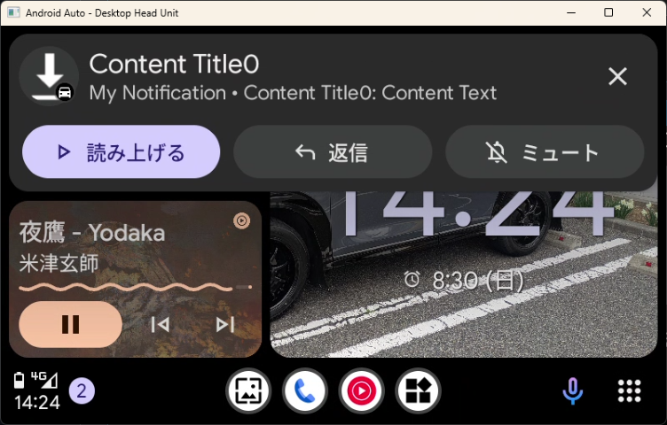
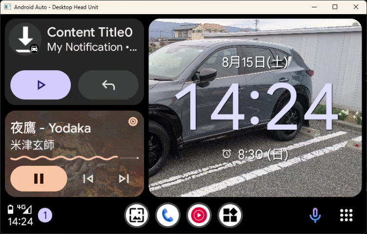
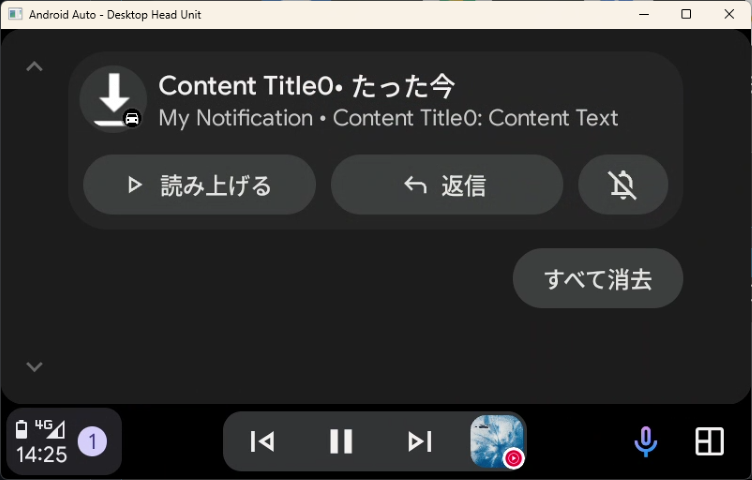
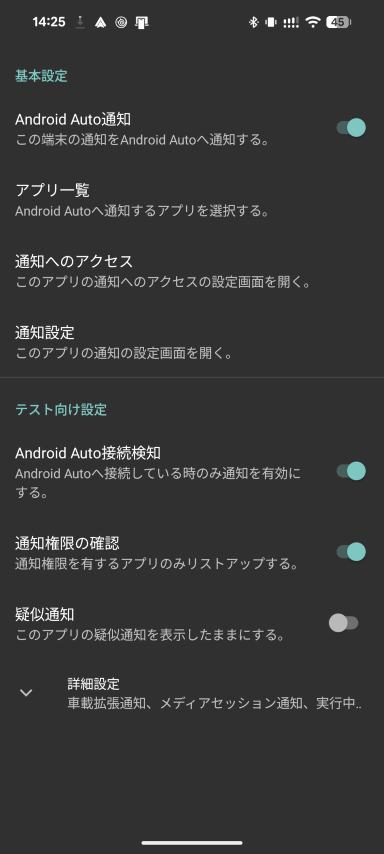
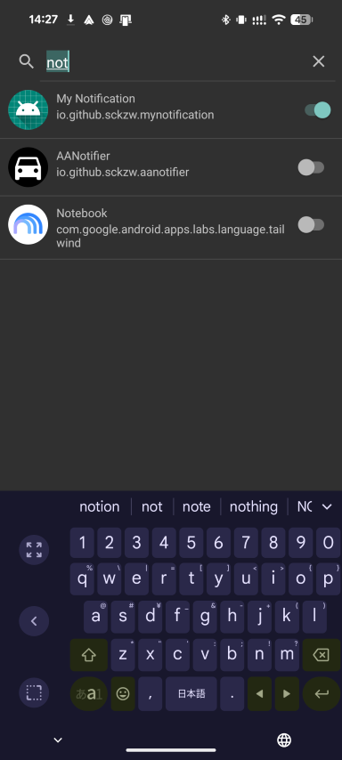
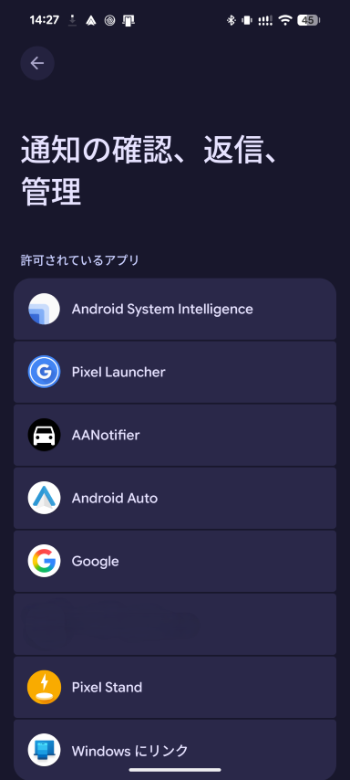

# AANotifier

Android Auto未対応のアプリの通知をAndroid Autoヘッドユニットに表示します。

## 必要アプリ・機器
- Android 9.0以上の端末
- [Android Autoアプリ](https://play.google.com/store/apps/details?id=com.google.android.projection.gearhead)
- Android Autoヘッドユニット (Android Auto対応ナビなど)

## インストール
本アプリはAndroid Autoのポリシーに準拠していないため、Google Playストアから配布できません。したがって、以下の手順に従ってインストールしてください。
1. [リリースページ](https://github.com/sckzw/AANotifier/releases)からAPKファイルをダウンロードし、端末にアプリをインストールしてください。
1. Android Autoの設定画面の一番下の「バージョン」をタップして「バージョンと権限情報」を表示します。
1. 「バージョンと権限情報」を10回タップします。
1. 「デベロッパー向けの設定を有効にしますか?」ダイアログが表示されるので、「OK」をタップします。これでデベロッパーモードが有効になります。
1. Android Autoの設定画面の右上のメニューから「デベロッパー向けの設定」をタップします。
1. 「デベロッパー向けの設定」画面の下の方の「提供元不明のアプリ」をチェックします。
1. Android 13以降の端末では[制限付き設定を許可](https://support.google.com/android/answer/12623953)してください。

## 設定
1. AANotifierのメイン画面の「Android Auto通知」のチェックが有効になっていることを確認してください。
1. AANotifierのメイン画面の「通知へのアクセス」をタップしてください。
    1. 表示された画面で、AANotifierの通知へのアクセスを許可してください。
    1. Android 13以降の端末では[制限付き設定を許可](https://support.google.com/android/answer/12623953)しておく必要があります。
1. AANotifierのメイン画面の「通知設定」をタップしてください。
    1. 表示された画面で、「AANotifier」チャネルをタップし、通知の設定をお好みに応じて変更してください。
    1. 初期設定では「サイレント」になっています。
1. AANotifierのメイン画面の「アプリ一覧」をタップしてください。
    1. 表示された画面で、Android Autoに通知を表示したいアプリのチェックを有効にしてください。

## 使用方法
1. Android Autoヘッドユニットに端末を接続し、Android Autoを起動してください。
1. AANotifierは常に表示しておく必要はないため画面を閉じてください。
1. 有効にしたアプリが通知を発行すると、Android Autoヘッドユニットにも通知が表示されます。

## 注意事項
1. 車載時に見る必要がない通知は有効にしないでください。
1. 通知内容は停車中に確認してください。
1. AANotifierの「テスト向け設定」は特に指示がなければ変更しないでください。

## スクリーンショット

# Main source code file
[MessagingService.java](https://github.com/sckzw/AANotifier/blob/master/mobile/src/main/java/io/github/sckzw/aanotifier/MessagingService.java "MessagingService.java")
